  

## About

> Great design isn't about how it looks. It's about how effortlessly people can use it.

I'm a **Senior Executive, UI/UX Designer at Backbencher Studio**, building digital products across **SaaS, Healthcare and FinTech**. I combine user research, visual craft and front-end fluency, so what I design is what gets built.

<table>
<tr>
<td width="50%" valign="top">

**What I do**

- Turn complex ideas into simple user journeys
- Build scalable design systems and components
- Wireframe, prototype and polish interfaces
- Work side by side with developers
- Speed up product design with AI-assisted workflows

</td>
<td width="50%" valign="top">

**What makes me different**

- A shipped product live on Google Play
- I write Tailwind, so handoff has fewer surprises
- I prototype with AI tools to test ideas in hours
- I design for accessibility from the first wireframe

</td>
</tr>
</table>

## How I Work

## Toolkit

## Featured Projects

<table>
<tr>
<td width="50%" align="center">

</td>
<td width="50%" align="center">

</td>
</tr>
<tr>
<td width="50%" align="center">

</td>
<td width="50%" align="center">

</td>
</tr>
</table>

Stability also has a full <a href="https://www.figma.com/design/1Hd56fNsZGUGQLyJdThM5i">Figma case study</a>.

## Currently Exploring

## GitHub Activity

 

  

 

## Let's Build Something Thoughtful

Have a product, a rough idea or a collaboration in mind? I'm open to meaningful conversations.

 

  

